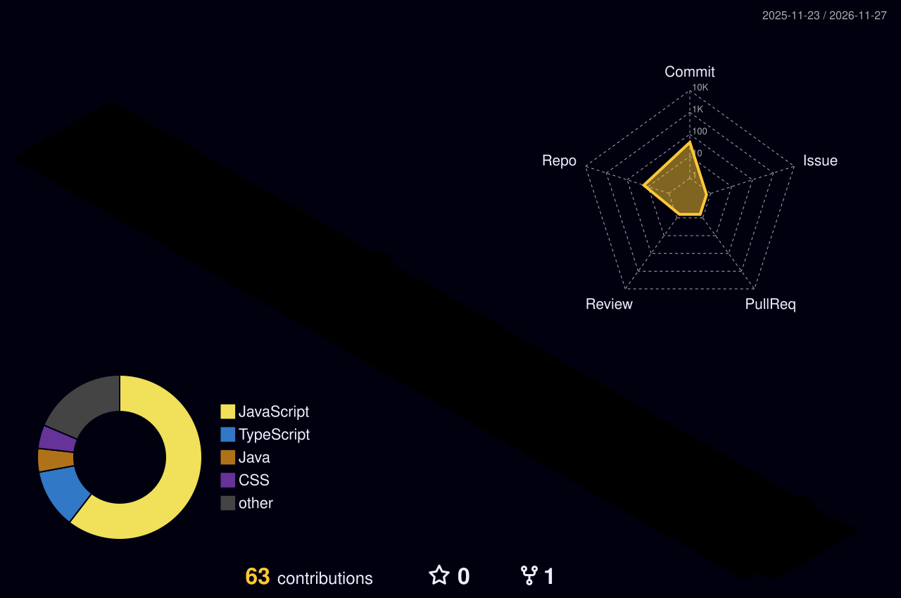

 
<div align="center">


</div>

## ◈ Developer Identity

```java
class Developer {
    String role = "Student Developer";
    String focus = "Problem Solving";
    String[] interests = {
        "Web Development",
        "3D Development",
        "Artificial Intelligence"
    };
    boolean keepLearning = true;
}
```

## ◈ Technology Arsenal

<div align="center">


</div>

## ◈ My 3D Contribution World

<div align="center">



</div>

## ◈ Development Activity

<div align="center">


</div>

<div align="center">


</div>
